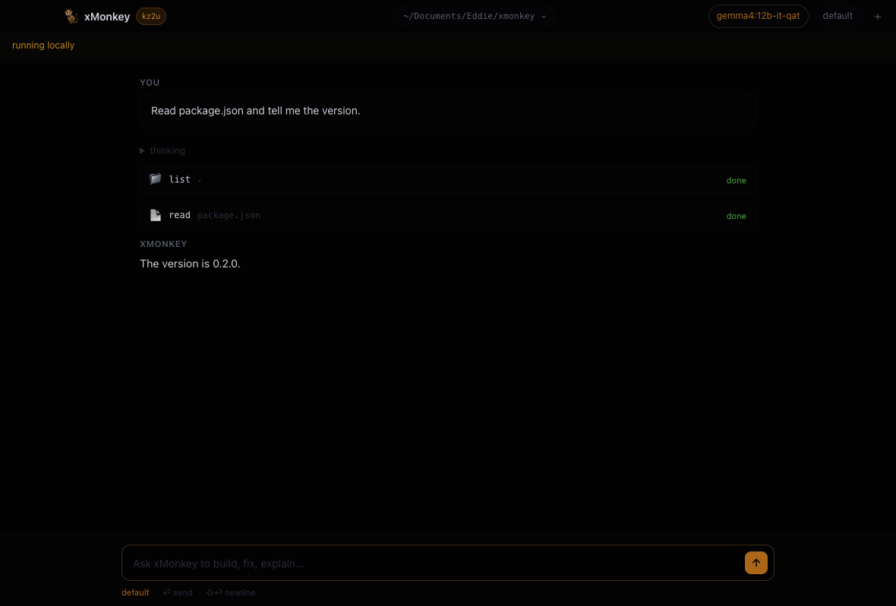
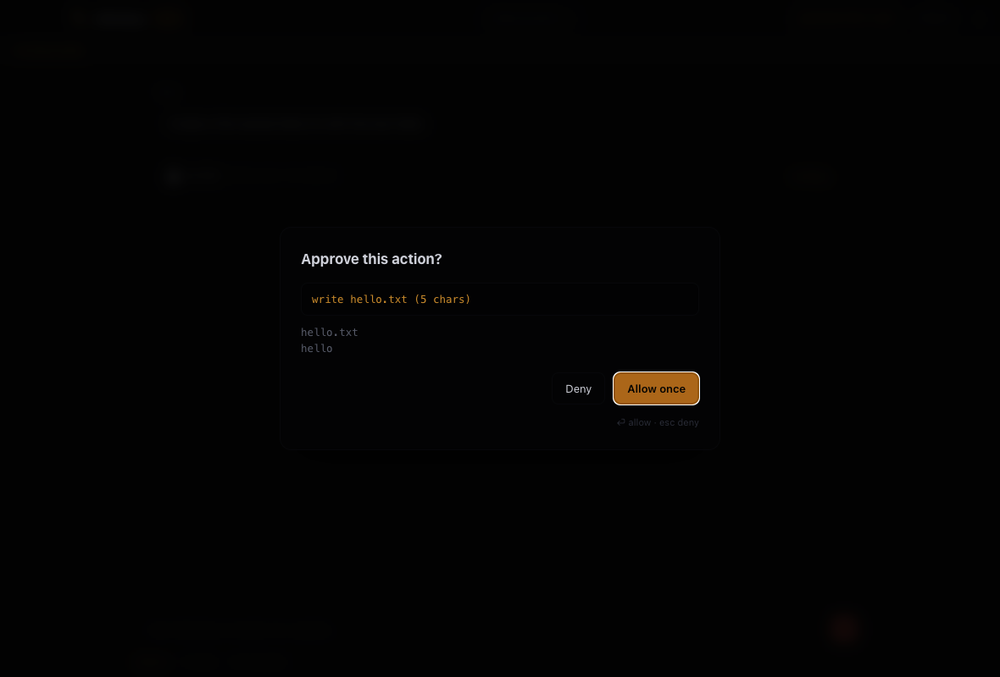

# xMonkey

A coding agent harness you point at **any** model — cloud or local.

xMonkey does the job Claude Code does: it reads your repo, edits files, runs
commands, and works through a task in a loop. The difference is that the model is
a swappable backend. `ollama`, LM Studio, llama.cpp, vLLM, OpenRouter, OpenAI,
Anthropic — same harness, same tools, same permission model. Local models are
first-class, not a fallback.

```
$ xmonkey "the parser drops trailing commas, fix it and add a test"
```

**Status:** working. 130 tests pass, including integration tests against a real
Ollama model running on this machine. Ships as **both** a CLI and a desktop app.

## Two ways to run it

<p align="center">
  
</p>

| | command | what it is |
|---|---|---|
| **Desktop app** | double-click `xMonkey.app` | native window, conversation, tool cards, approval dialogs |
| **CLI** | `xmonkey` | terminal, `--print` for scripting, sessions, resume |

Both drive the *same* agent (`src/app/session.mjs` → `src/core/loop.mjs`). The app
is a renderer of the event stream, not a second implementation — so a fix in the
loop reaches both, and the two cannot drift apart.

### Building the desktop app

```bash
npm install              # once, for Electron
npm run app:build        # -> dist/xMonkey.app
npm run app:dist         # -> also copies to /Applications
open dist/xMonkey.app
```

The packager is `tools/build-app.mjs`: it copies the local Electron runtime,
rewrites the bundle identity, installs the generated icon and ad-hoc signs the
result. No network, no extra toolchain.

**The icon is generated, not a binary blob** — `node tools/make-icon.mjs` draws
the monkey mark in pure Node (zlib PNG writer + a tiny rasteriser) and builds the
`.icns` with the system `iconutil`. Rebuilding always produces the same icon.

### Verifying the app without clicking

The app can test itself, which is how its UI was verified while building it:

```bash
# screenshot the welcome screen
dist/xMonkey.app/Contents/MacOS/xMonkey --smoke=/tmp/shot.png

# drive a real turn in a real project, then screenshot
dist/xMonkey.app/Contents/MacOS/xMonkey \
  --smoke=/tmp/shot.png\&cwd=/path/to/project\&ask=Read%20package.json%20and%20summarise%20it

# also capture the approval dialog (it is left on screen, then answered)
... \&perm

# answer the dialog with Deny instead, to prove the refusal path
... \&deny
```

`--smoke` prints the renderer's state as JSON (API present, errors, thread
length) and exits non-zero if the window fails to render. That is what caught the
packaged-bundle bugs: a wrong resource path and an auto-detected model the app
could show but not start.

---

## Why

<p align="center">
  
</p>


Frontier coding agents are excellent and tied to one vendor. Local models are
getting good enough to drive tools, but most harnesses treat them as a
degraded mode: they assume native tool calling, a 200k context, and a
reliable instruction-follower. xMonkey assumes none of that.

| | Claude Code | xMonkey |
|---|---|---|
| model | Anthropic only | any endpoint; local first-class |
| no native tool calling | not supported | prompted-JSON fallback (`src/models/prompted.mjs`) |
| reasoning models | vendor channel | thinking blocks preserved, empty turns impossible |
| context window | 200k assumed | capability-driven, honest compaction |
| permission model | fixed modes | configurable modes + rules + input-parameter rules |
| source | closed | this repo |

---

## Quickstart

Requires Node ≥ 22. No dependencies to install — xMonkey runs from source.

```bash
git clone <this repo> xmonkey && cd xmonkey

# 1. Have a model available. Any one of these works:
ollama pull qwen2.5-coder:7b          # local, free
#   ...or point at LM Studio / llama.cpp / vLLM
#   ...or export ANTHROPIC_API_KEY / OPENAI_API_KEY

# 2. Run it. With no config, xMonkey finds a local model server automatically.
node bin/xmonkey.mjs

# In a project:
node bin/xmonkey.mjs "explain what src/ does, then add a README"
```

Optional: put it on your PATH.

```bash
npm link          # then just: xmonkey
```

### Headless / scripting

```bash
xmonkey -p "list every TODO in src and summarise"         # print answer, exit
xmonkey -p --yes "add a LICENSE file"                     # pre-approve mutations
xmonkey -p --mode read "what does this repo do?"          # plan mode: read-only
```

Exit code is `0` on a completed turn, non-zero otherwise — safe in CI.

---

## Choosing a model

`xmonkey --init` writes an `xmonkey.config.json`:

```json
{
  "models": {
    "local":    { "kind": "ollama",   "baseUrl": "http://127.0.0.1:11434", "model": "qwen2.5-coder:7b" },
    "lmstudio": { "kind": "lmstudio", "baseUrl": "http://127.0.0.1:1234/v1", "model": "local-model" },
    "sonnet":   { "kind": "anthropic", "model": "claude-sonnet-4-5" },
    "gpt":      { "kind": "openai",    "model": "gpt-4o-mini" }
  },
  "default": "local",
  "permissions": { "mode": "default", "rules": [] },
  "loop": { "maxTurns": 60 }
}
```

```bash
xmonkey --list-models              # what is configured
xmonkey doctor                     # probe every endpoint for real
xmonkey -m sonnet                  # use a named model
xmonkey --kind ollama --model llama3.1   # or specify one inline
```

Config precedence: CLI flags → `./xmonkey.config.json` → `~/.config/xmonkey/config.json`
→ environment → auto-detected local server.

### `kind` values

`ollama`, `lmstudio`, `llama.cpp`, `vllm`, `openrouter`, `deepseek`, `groq` all
speak the OpenAI-compatible API and are interchangeable. `anthropic` uses the
native Messages API. Any other OpenAI-compatible endpoint works with
`kind: "openai"` plus a `baseUrl` — that is the whole extension mechanism.

### Models that cannot call tools

Some local models have no tool-calling API. Point xMonkey at one anyway:

```json
{ "kind": "openai", "baseUrl": "http://127.0.0.1:8000/v1", "model": "my-model", "nativeTools": false }
```

xMonkey then renders the tool catalogue into the prompt and parses a fenced JSON
block back out (`src/models/prompted.mjs`). A 7B base model can drive the same
tools a frontier model does — less reliably, but genuinely.

---

## Permissions

Every tool call passes one gate, in `src/permissions/gate.mjs`.

| mode | read-only tools | file writes | shell | prompts? |
|---|---|---|---|---|
| `plan` | ✅ | ❌ denied | ❌ denied | no |
| `default` | ✅ | ask | ask (safe cmds allowed) | yes |
| `acceptEdits` | ✅ | ✅ | ask | sometimes |
| `dontAsk` | ✅ | ❌ denied | safe allowed | never |
| `bypass` | ✅ | ✅ | ✅ | never |
| `auto` | ✅ | ask | safe allowed | sometimes |

Rules are evaluated before the mode, and a deny always wins:

```json
{
  "permissions": {
    "mode": "default",
    "rules": [
      { "tool": "bash", "pattern": "^git (status|diff|log)", "action": "allow" },
      { "tool": "bash", "field": "command", "pattern": "^rm\\s", "action": "deny" },
      { "tool": "read", "path": "secrets/**", "action": "deny" }
    ]
  }
}
```

- `tool` alone → whole-tool rule
- `field` + `pattern` → **input-parameter rule** (deny `rm` without denying `bash`)
- `path` → path glob rule

`--yes` maps to `bypass`. `dontAsk` is the right mode for unattended runs you do
not fully trust.

**Read-only shell detection is conservative on purpose.** Redirection,
command substitution and subshells disqualify a command from being called
read-only, because a wrong "read-only" is an unprompted mutation.

---

## How a turn works

```
user message
   │
   ├─ check context budget ──── too big? compact (honestly, with a marker)
   ├─ model call (streaming)
   ├─ stop_reason == tool_use?
   │     ├─ for each tool call:
   │     │    hooks → permission gate → execute → clip output
   │     │    a refusal is a tool_result with is_error, never an exception
   │     └─ append results, loop
   └─ otherwise: done
```

Invariants that the tests enforce:

1. Every `tool_use` gets exactly one `tool_result` — an unbalanced history makes
   a model incoherent.
2. A refusal is **data**, not a crash. The model sees "no" and adapts.
3. Budget is checked **before** the call, so a call is never made with no room to
   act on the answer.
4. Compaction never invents a summary. It leaves a visible marker saying how many
   messages were dropped, because a fabricated summary is indistinguishable from
   fact to the model.

---

## Tools

| tool | purpose | read-only | concurrency-safe |
|---|---|---|---|
| `read` | line-numbered file read, paginated | ✅ | ✅ |
| `write` | create/overwrite (creates parents) | ❌ | ❌ |
| `edit` | exact string replace; refuses ambiguity | ❌ | ❌ |
| `list` | directory listing, skips vendor dirs | ✅ | ✅ |
| `glob` | find by pattern, newest first | ✅ | ✅ |
| `grep` | regex content search, `file:line` output | ✅ | ✅ |
| `bash` | one command, timeout, capped output | ❌ | ❌ |
| `todo` | session checklist | ❌ | ❌ |
| `skill` | load an installed SKILL.md | ✅ | ✅ |
| `task` | delegate to a fresh subagent | ❌ | ✅ |
| `mcp__<server>__<tool>` | any MCP server's tool | per server | ❌ |

Paths are confined to the workspace by default; `--allow-outside` widens it
deliberately.

---

## Extensibility

**MCP servers.** Any stdio or HTTP MCP server, configured in `xmonkey.config.json`:

```json
{
  "mcpServers": {
    "filesystem": { "command": "npx", "args": ["-y", "@modelcontextprotocol/server-filesystem", "."] },
    "remote": { "url": "http://127.0.0.1:8080/mcp" }
  }
}
```

Tools appear as `mcp__filesystem__read_file`. A broken server is reported and
skipped; it never takes the session down.

**Skills.** A directory with `SKILL.md`, discovered from `~/.xmonkey/skills/` and
`<project>/.xmonkey/skills/`. Only the name and description go in the prompt —
the body loads on demand, which is what makes skills usable on a small context.

```markdown
---
name: commit
description: Write a good commit message for staged changes.
---
1. Run `git diff --staged` ...
```

Invoke with `/commit`, or let the model load it with the `skill` tool.

**Hooks.** Shell commands around tool calls:

```json
{
  "hooks": {
    "PreToolUse":  [{ "matcher": "bash|write", "command": "node scripts/guard.mjs" }],
    "PostToolUse": [{ "matcher": "edit", "command": "./format.sh" }]
  }
}
```

A `PreToolUse` hook may deny, ask, or rewrite the input:

```json
{ "decision": "deny", "reason": "no writes under vendor/" }
{ "updatedInput": { "command": "npm test -- --silent" } }
```

Hooks run **before** the permission gate, so a project guard holds even in
`bypass` mode. Events: `PreToolUse`, `PostToolUse`, `SessionStart`, `SessionEnd`,
`Stop`, `UserPromptSubmit`, `PreCompact`.

**Subagents.** The `task` tool hands a self-contained brief to a fresh agent with
its own context. Depth is capped; the child defaults to read-only; the child can
never prompt (a prompt inside a subagent is a silent deadlock headless).

---

## Sessions

Every session is an append-only JSONL file:

```
~/.xmonkey/sessions/<id>/transcript.jsonl
~/.xmonkey/sessions/<id>/meta.json
```

```bash
xmonkey --sessions              # list recent
xmonkey --resume <id-prefix>    # continue
```

Append-only means a crash loses at most the last record, never the transcript.
A torn final line is skipped, not fatal.

---

## Model-layer details

The canonical message format lives in `src/core/types.mjs`. Adapters translate
to and from their wire dialect; nothing above `src/models/` knows the vendor.

```
anthropic.mjs   Messages API, tool_use blocks, cache_control, thinking
openai.mjs      /v1/chat/completions, function calls, SSE, reasoning_content
ollama.mjs      /api/chat NDJSON + OpenAI dialect, thinking stream, stats
prompted.mjs    wraps any of the above for models without native tool calling
registry.mjs    config -> live provider; `kind` aliases; doctor probes
```

Capabilities each provider declares, and what they change:

| flag | effect when false |
|---|---|
| `nativeTools` | prompted-JSON protocol instead of a tool API |
| `systemRole` | system prompt folded into the first user turn |
| `thinking` | reasoning channel not requested or rendered |
| `streaming` | single non-streaming call |
| `contextWindow` | compaction budget |

### Reasoning models

Models like Gemma-4, Qwen3 and DeepSeek-R1 distillations stream their entire
output into a `thinking` field and leave `content` empty — sometimes for hundreds
of tokens. xMonkey preserves that as a `thinking` block and guarantees the turn
is never empty. This was a real bug found by the local-model test suite; it is
now a regression test.

---

## Development

```bash
node --test test/                 # 108 tests, no network needed
node --test test/e2e-local.test.mjs   # REQUIRES a local Ollama chat model
node bin/xmonkey.mjs doctor       # is everything reachable?
```

The suite is hermetic except `e2e-local`, which skips cleanly when no local model
is available. The tests that matter most:

| file | proves |
|---|---|
| `test/models.test.mjs` | every adapter parses its dialect; prompted fallback works |
| `test/loop.test.mjs` | turn cycle, refusals, compaction, hooks, gate ordering |
| `test/tools.test.mjs` | each tool's real pass **and** real fail |
| `test/ext.test.mjs` | MCP over a real child process, hooks, skills, subagents |
| `test/cli.test.mjs` | the real binary end to end against a fake model server |
| `test/e2e-local.test.mjs` | a real local model driving real tools |

## Layout

```
bin/xmonkey.mjs          entry point
src/core/                types, agent loop, system prompt
src/models/              provider adapters + registry
src/tools/               tool registry, files, shell, search, todo
src/permissions/         the gate
src/sessions/            JSONL persistence
src/ext/                 mcp, hooks, skills, subagent
src/cli/                 argument parsing, terminal UI
docs/XMONKEY-SPEC.md     architecture + gap analysis
research/                reverse-engineering findings on the reference harness
```

## License

MIT.
